SUSE LINUX包含一个救援系统，用于在紧急情况下从外部访问您的LINUX分区。救援系统可以通过CD、网络或SUSE FTP服务器加载。此外，还有一个可引导的SUSE LINUX CD/DVD，可以用作救援系统。救援系统包括几个帮助程序，您可以补救大问题，无法访问的硬盘，错误配置的配置文件，或其他类似的问题。

救援系统是通过CD(或DVD)发射的。光驱必须是可引导的。如果需要，可以在BIOS设置中修改引导顺序。

**启动救援系统的步骤**
1. 设置系统BIOS，更改服务器引导设备顺序，或者在启动过程中通过快捷键（不同厂商服务器快捷键不一样）调出启动菜单并手动选择从光盘启动；
2. 在驱动器中插入第一张SUSE LINUX CD或DVD，然后打开电源，驱动器可以是物理光驱也可以是虚拟化提供的虚拟光驱也可以是服务器带外管理模块提供的虚拟虚拟介质挂载；
3. 从光盘启动菜单中选择进入救援系统，选择系统语言并等待救援系统启动完成。

**图例，启动SLES11SP4救援系统**
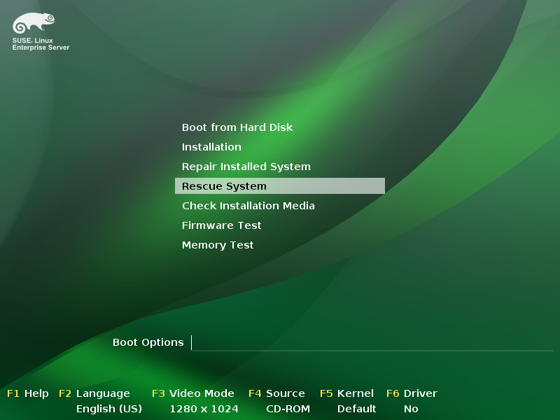

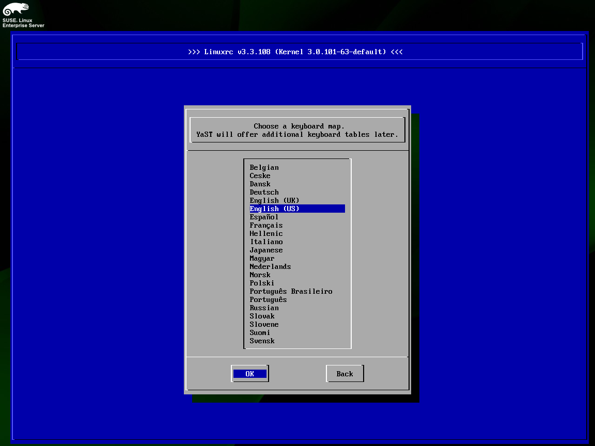

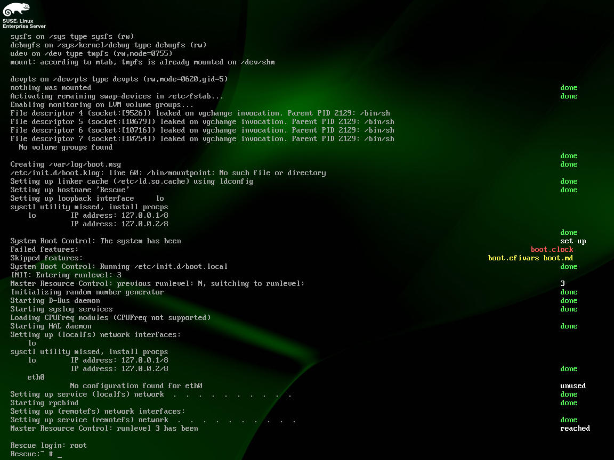

**图例，启动SLES12SP3救援系统**
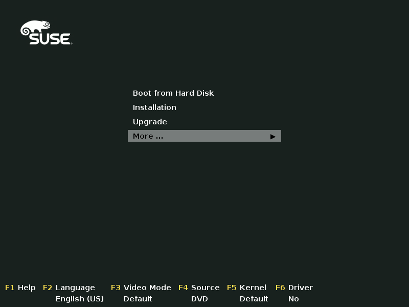

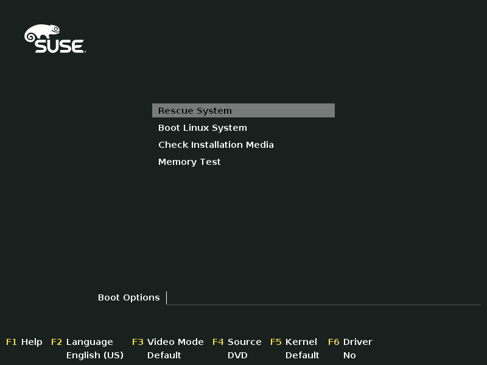

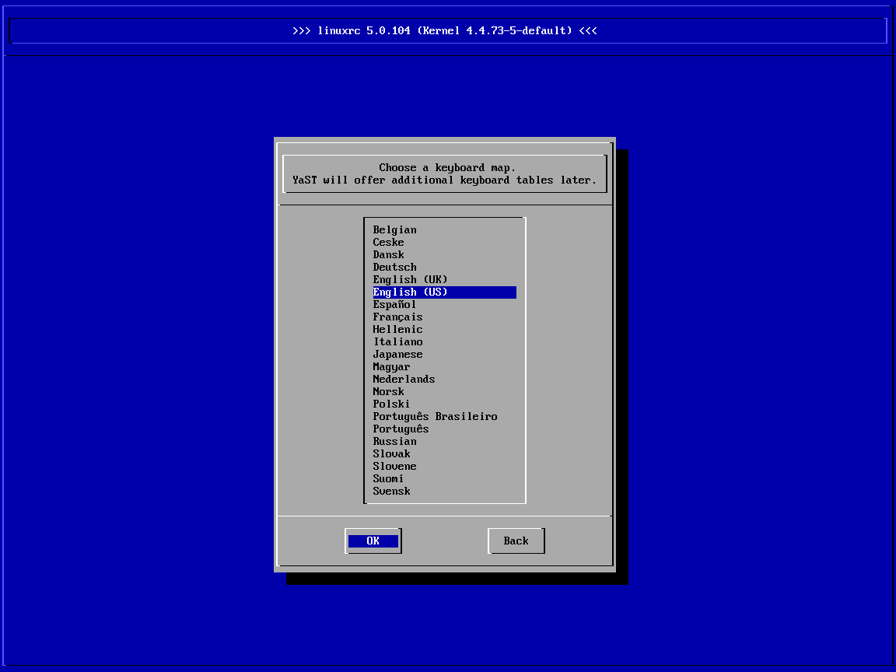

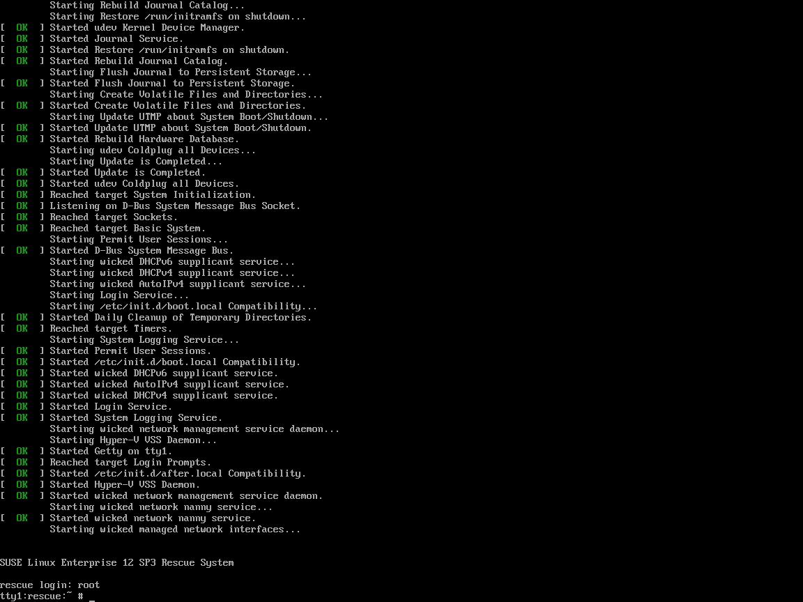

**在救援系统中进行磁盘错误检查**
1. 首先在救援系统下列出所有块设备，并确认需要进行文件系统检查的磁盘设备；
2. 对指定磁盘设备执行fsck，注意，磁盘检查操作不允许挂载。

**图例，SLES11SP4救援系统中检查并修复文件系统**
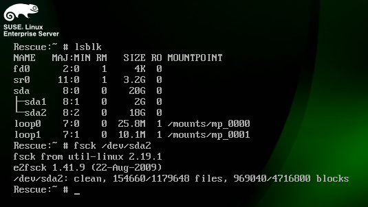

**图例，SLES12SP3救援系统中检查并修复文件系统**
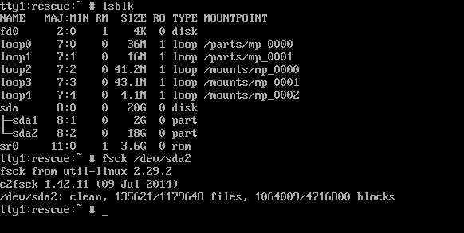

**在救援系统中进行错误配置恢复**
1. 首先在救援系统下找到原系统的根分区磁盘（或原系统相关配置文件所在磁盘），并将其挂载出来以便访问；
2. chroot至原操作系统根挂载点；
3. 在挂载点中找到需要修改调整的配置文件，对其进行修改并保存退出；
4. 卸下已挂载的磁盘设备，并重启服务器。

**图例，SLES11SP4救援系统中进行Grub配置修复**
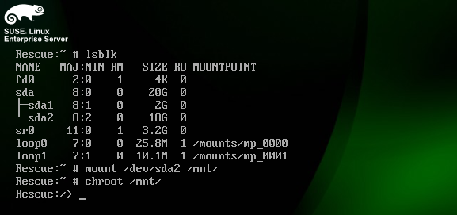

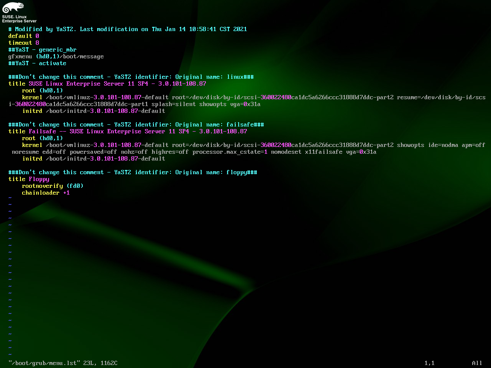

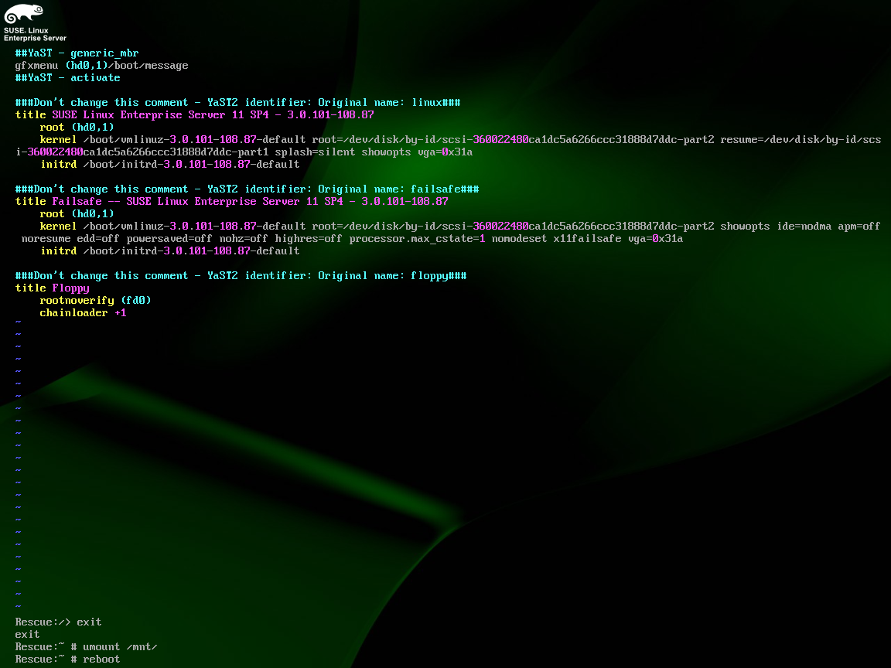

**图例，SLES12SP3救援系统中进行Grub2配置修复**
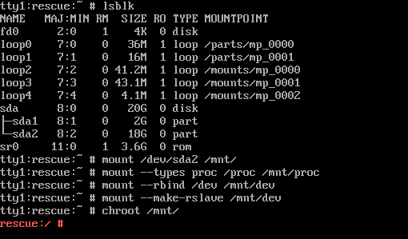

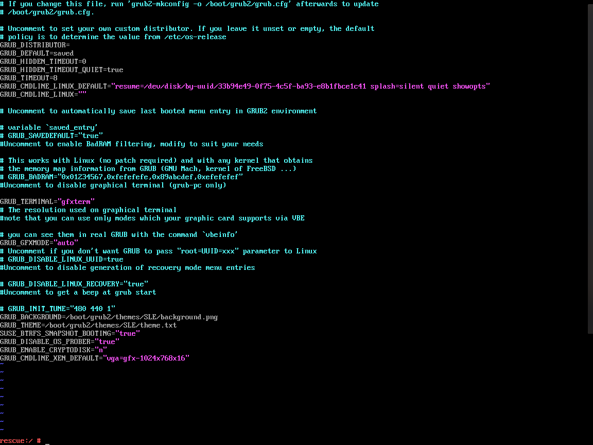

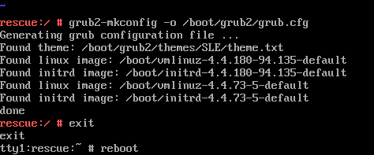

**在救援系统中进行软件包管理**
1. 首先在救援系统下按原操作系统目录结构，从根分区开始依次挂载所有相关分区（交换分区可以不用挂载）；
2. chroot至原操作系统根挂载点；
3. 挂载需要重装、升级或降级的RPM软件包所在介质，可以是光盘ISO、FTP服务器、NFS服务器等（如需通过网络访问介质，需要先进行救援系统网络配置）；
4. 执行RPM管理命令（注意：救援系统下没有zypper工具）；
5. 卸下已挂在的磁盘设备，并重启服务器。

**图例，SLES11SP4救援系统中降级openssl-cert软件包**
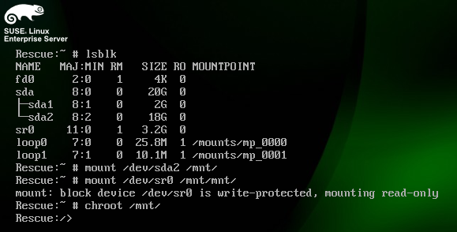

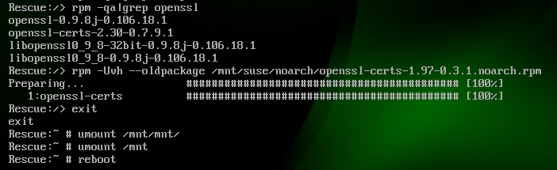

**图例，SLES12SP3救援系统中降级openssl-doc软件包**
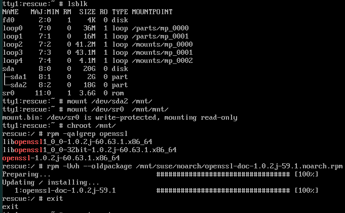

**在救援系统中进行密码恢复**
1. 首先在救援系统下按原操作系统目录结构，从跟分区开始依次挂载所有相关分区（交换分区可以不用挂载）；
2. 挂载/dev至原系统根分区挂载点下；
3. chroot至原系统跟分区挂载点；
4. 执行passwd命令对用户进行密码更改；
5. 退出chroot并重启操作服务器。

**图例，SLES11SP4重设root密码**
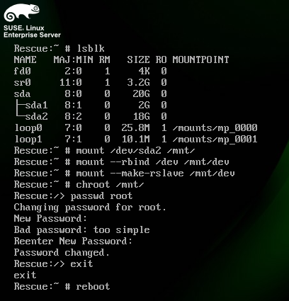

**图例，SLES12SP3重设root密码**
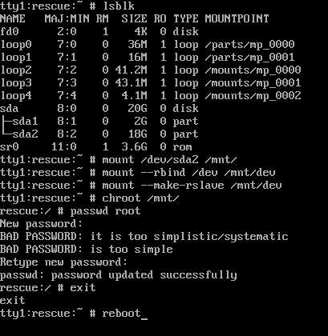
